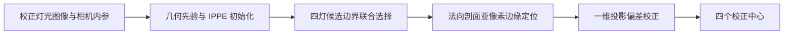

# 四灯中心定位主流程

本仓库仅提供正式算法的四阶段定位主流程与运行所需的公共模块。不包含照片、逐图实验结果、基线对比入口、统计分析、论文图表或专利文件。



## 运行

使用 Python 3.12，安装依赖后运行：

```bash
python -m pip install -r requirements.txt
python main.py --image /path/to/light.jpg --camera /path/to/camera.json --output outputs/centers.json
```

需要固定 ROI 时增加 `--roi /path/to/roi.json`。

输入必须是已去畸变的灯光图像；`camera.json` 包含对应的 `new_K` 或 `K` 3×3 矩阵，按零畸变使用。本仓库不进行相机标定或图像去畸变。

相机 JSON 格式示例（示例值须替换为实际标定结果）：

```json
{"new_K": [[1000,0,960],[0,1000,540],[0,0,1]]}
```

ROI JSON 格式示例（原图像素坐标）：

```json
{"roi_points": [[100,100],[1800,100],[1800,1000],[100,1000]]}
```

输出 `centers_px` 为四个校正中心，`stage_centers_by_layout` 保留粗中心、支撑椭圆中心、亚像素中心、校正中心；`projective_correction` 记录校正是否生效及回退原因。整个入口不读取棋盘格、不计算参考真值或七种基线。

## 四阶段

1. **几何先验**：粗检测和四灯对应搜索，采用 IPPE，在正深度条件下选取重投影误差最小的初始位姿，形成平面与理论圆投影先验；不进行位姿非线性细化。
2. **边界选择**：对四灯多层候选边界进行几何一致性联合选择，得到支撑椭圆及其中心。
3. **亚像素定位**：沿边界法向分析灰度剖面，结合物理半径约束生成边缘点并重拟合椭圆；失败时回退到支撑椭圆中心。
4. **投影偏差校正**：从布局估计方向 `d` 和符号 `mu`；由椭圆半轴 `a ≥ b` 计算公共形变尺度 `kappa = median((a²-b²)/a)`。可靠性门控通过时，`c_final = c_subpixel + mu*kappa*d`，否则保持原中心。该幅值是形变尺度，不是精确投影偏差的解析解；正式实现不采用拟合增益或最大位移截断。

## 固定灯阵参数

四个世界坐标（mm）为 `[-25,275,0]`、`[375,275,0]`、`[-25,675,0]`、`[375,675,0]`，物理半径为 **10 mm**。这些是当前主流程的实际参数；辅助模块中的其他默认值不代表本入口。

四灯构成正方形，几何对应存在对称分支。输出顺序对应算法选出的布局分支，不代表已唯一识别灯具物理身份。

## 文件说明

- `main.py`：主入口与四阶段调用顺序；也可调用 `localize(image, K, roi_points=None)`。
- `pipeline_stages.py`：从正式实现提取的亚像素定位、形变幅值和可靠性校正函数。
- `ippe_only_pose_experiment.py`：正式 IPPE 初始化模块，保留原文件名。
- 其他 Python 文件：边界、几何、位姿上下文和 ROI 公共依赖。部分公共模块仍保留历史辅助函数以维持原导入关系，主入口不会执行其中的实验评价路径。

无照片随包分发，请自行提供输入。主流程由正式实现整理，原研究项目未修改。许可证未代作者指定。
